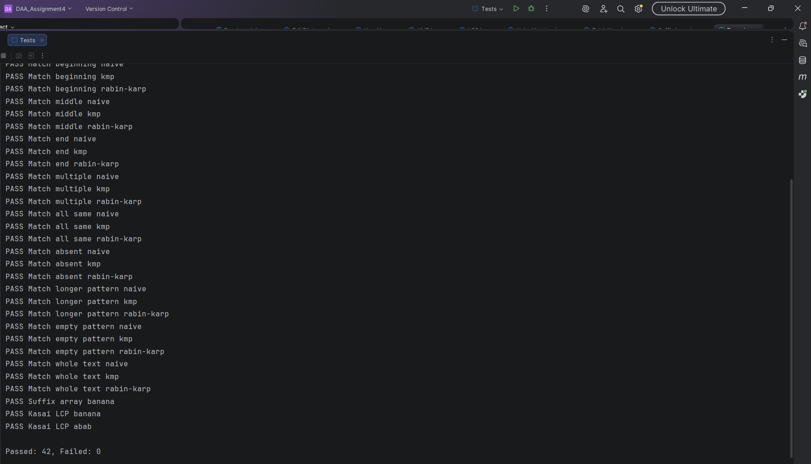
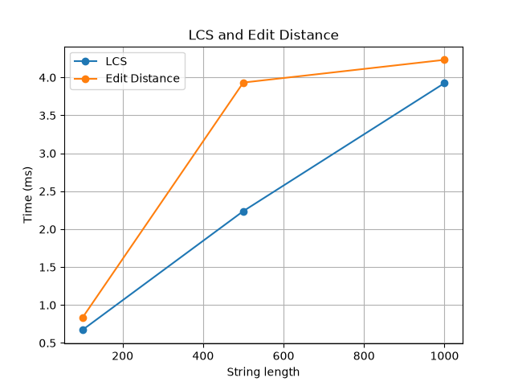
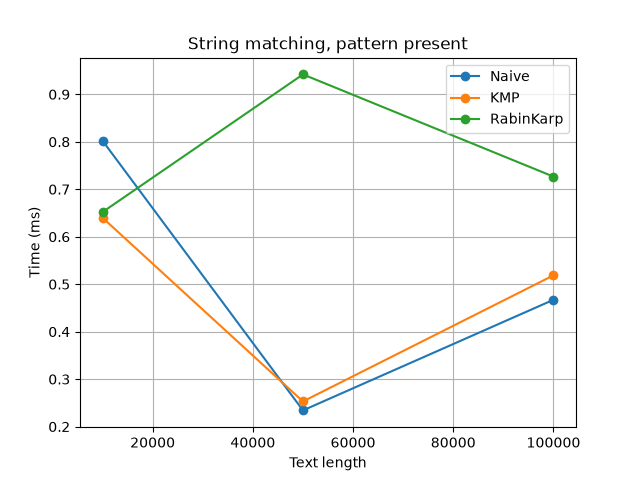
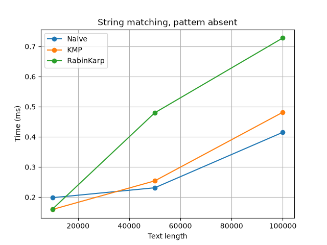
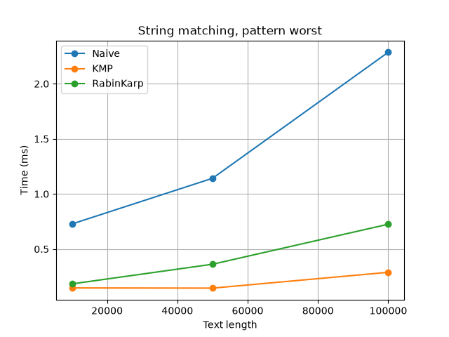
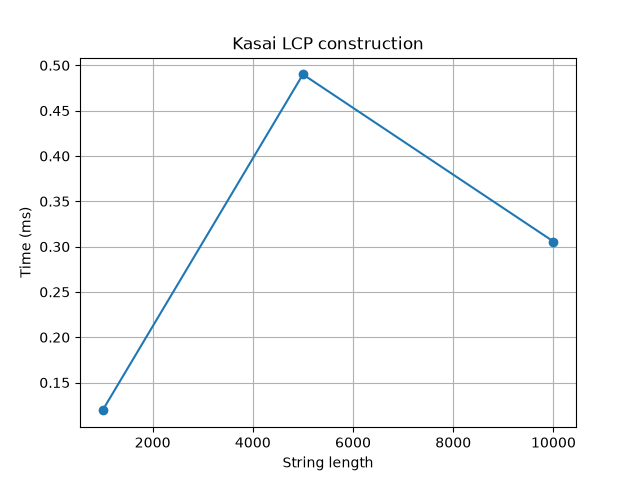

# Assignment 4: Text Analysis with Dynamic Programming and String Algorithms

## 1. Problem description and algorithm overview

This project implements text analysis algorithms in Java without using library replacements.

| Part | Algorithm | What it does |
|------|-----------|--------------|
| A | LCS | Length of the longest subsequence shared by two strings |
| A | Edit Distance | Minimum insertions, deletions and substitutions to turn one string into another |
| B | Naive matching | Tries every start position in the text |
| B | KMP | Uses the LPS (prefix) table to never move backwards in the text |
| B | Rabin-Karp | Compares rolling hashes and checks characters only when hashes match |
| C | Kasai | Builds the LCP array from a string and its suffix array |

## 2. Implementation decisions and assumptions

- Language: Java 21, no external libraries. Tests are a plain `Tests` class with a `main` method (no JUnit).
- Empty pattern: all three matchers return an empty list (no occurrences).
- Pattern longer than the text: empty list.
- Overlapping occurrences are all reported (`aba` in `abababa` gives 0, 2, 4).
- Rabin-Karp uses base 256 and modulus 1,000,000,007. Every hash match is verified character by character, so a collision never gives a wrong result.
- `SuffixArray` is a simple sort of suffix indices with a custom suffix comparator. It is only used to prepare input for Kasai, and it is not timed.
- LCP convention: `lcp[0] = 0` and `lcp[i]` is the LCP of suffixes `sa[i-1]` and `sa[i]`.
- Alphabet for random strings: `abcd`. Random seed: `42`.
- Operation counts: character comparisons for Naive, KMP (LPS building plus search) and Rabin-Karp (only the verification comparisons after a hash match; hash updates are not counted).

## 3. Complexity analysis

n = text length, m = pattern length (or the lengths of the two strings for DP).

| Algorithm | Main operation / recurrence | Best case | Worst case | Aux. space | Explanation |
|-----------|-----------------------------|-----------|------------|------------|-------------|
| LCS | `dp[i][j] = dp[i-1][j-1]+1` if chars equal, else `max(dp[i-1][j], dp[i][j-1])`; `dp[0][*] = dp[*][0] = 0` | O(nm) | O(nm) | O(nm) | Every cell of the (n+1)x(m+1) table is filled once in O(1) |
| Edit Distance | `dp[i][j] = dp[i-1][j-1]` if equal, else `1 + min(replace, delete, insert)`; `dp[i][0]=i`, `dp[0][j]=j` | O(nm) | O(nm) | O(nm) | Same table size, O(1) work per cell |
| Naive | Compare pattern with text at every shift | O(n) (first char mismatches each time) | O(nm) (e.g. `aaaa...` and `aaa...b`) | O(1) | n-m+1 shifts, up to m comparisons each |
| KMP | Build LPS, then scan text and use LPS on mismatch | O(n + m) | O(n + m) | O(m) | The text index never moves back, so each text char is compared a constant amortized number of times. LPS building is O(m) by the same argument |
| Rabin-Karp | Rolling hash `h = (h - t[i]*base^(m-1))*base + t[i+m]` mod p | O(n + m) | O(nm) | O(1) | Expected O(n + m) because collisions are rare. Worst case if many windows collide and need a full check |
| Kasai | `h` decreases by at most 1 when moving from suffix i to i+1 | O(n) | O(n) | O(n) | `h` increases at most 2n times in total, since it drops by at most 1 per step. Needs the rank array and the LCP array |

Theoretical complexity describes how the number of operations grows with input size. Measured time (section 6) also depends on the JVM, the JIT compiler, caches and the machine, so the two do not have to match exactly.

### Why the recurrences are correct

- **LCS:** if the last characters of the two prefixes match, they can always be added to an optimal common subsequence of the shorter prefixes, so the answer is `dp[i-1][j-1] + 1`. If they differ, at least one of them is not in the LCS, so we take the better of dropping the last character of one string or the other.
- **Edit Distance:** the last characters are either equal (no cost) or the last operation is a substitution (`dp[i-1][j-1]`), a deletion (`dp[i-1][j]`) or an insertion (`dp[i][j-1]`), each costing 1. The minimum over these choices is optimal. Base cases: turning a string of length i into an empty string needs i deletions, and the other way round needs j insertions.

### How KMP avoids repeated comparisons

`lps[j]` stores the length of the longest proper prefix of the pattern that is also a suffix of `pattern[0..j]`. After a mismatch at pattern position j, the last `lps[j-1]` matched characters are already known to match the start of the pattern, so the pattern is shifted and only continues from `lps[j-1]`. The text pointer is never moved back.

### How Rabin-Karp handles collisions

Two different strings can have the same hash. When the window hash equals the pattern hash, the code compares the actual characters. Only a full character match is added to the result, so collisions cost time but never cause wrong answers.

### What the LCP array represents

For a string s with suffix array `sa`, `lcp[i]` is the length of the longest common prefix of the suffixes starting at `sa[i-1]` and `sa[i]`. Kasai processes suffixes in text order and uses the fact that if suffix i has LCP h with its predecessor, then suffix i+1 has LCP at least h-1.

## 4. Testing strategy and results

Tests are in `src/main/java/Tests.java`.

| Area | Cases |
|------|-------|
| LCS | identical strings, completely different, empty string (both sides), classic `ABCBDAB` / `BDCABA` = 4 |
| Edit Distance | identical, one empty string (both sides), substitution, insertion, deletion, `kitten` / `sitting` = 3 |
| String matching | pattern at beginning, middle, end, multiple overlapping occurrences, all same characters, absent, longer than text, empty pattern, pattern equal to text |
| Kasai | `banana`: suffix array `[5,3,1,0,4,2]`, LCP `[0,1,3,0,0,2]`; `abab`: suffix array `[2,0,3,1]`, LCP `[0,2,0,1]` |

For every matching test, Naive, KMP and Rabin-Karp are each compared with the expected list of indices. The benchmark also throws an error if the three algorithms ever return different results.

Result: 

Manual check for `banana`:

| i | sa[i] | suffix | lcp[i] |
|---|-------|--------|--------|
| 0 | 5 | a | 0 |
| 1 | 3 | ana | 1 |
| 2 | 1 | anana | 3 |
| 3 | 0 | banana | 0 |
| 4 | 4 | na | 0 |
| 5 | 2 | nana | 2 |

## 5. Experimental setup

| Experiment | Input sizes |
|------------|-------------|
| LCS | two random strings of length 100, 500, 1000 |
| Edit Distance | the same strings as LCS |
| String matching | text length 10,000, 50,000, 100,000 |
| Kasai | string length 1,000, 5,000, 10,000 |

- Alphabet: `abcd`, random seed 42 (`java.util.Random`).
- String matching scenarios (same text and pattern for all three algorithms):
  - **present:** a pattern of length 20 taken from the middle of the text.
  - **absent:** a random pattern of length 20 that was checked to not occur in the text.
  - **worst:** text of only `a` and pattern of 20 `a` followed by `b` (worst case for Naive).
- Timing: `System.nanoTime()`, one untimed warm-up run, then 5 timed runs, and the average is reported. Input generation, console output and file writing are outside the timed regions.
- Kasai is timed with the suffix array already built.
- Machine:
  - java version "1.8.0_51"
    Java(TM) SE Runtime Environment (build 1.8.0_51-b16)
    Java HotSpot(TM) 64-Bit Server VM (build 25.51-b03, mixed mode)
  - CPU: Intel Core i5-12500H
  - GPU: RTX3050 laptop
  - RAM: 16GB
  - OS: Windows 11 Pro(25H2)

## 6. Results

Raw data is saved in `results/dp.csv`, `results/matching.csv` and `results/kasai.csv` when the benchmark runs.

### LCS and Edit Distance (average of 5 runs)

| Length | LCS (ms) | Edit Distance (ms) |
|--------|----------|--------------------|
| 100 | 0.67028 |0.83036 |
| 500 | 2.23782 |3.93294 |
| 1000 | 3.92578|4.2325 |



### String matching (average of 5 runs)


| Scenario | Text length | Algorithm | Time (ms) | Comparisons | Matches |
|----------|-------------|-----------|-----------|-------------|---------|
| present | 10,000 | Naive | 0.802 | 13,433 | 1 |
| present | 10,000 | KMP | 0.640 | 12,544 | 1 |
| present | 10,000 | Rabin-Karp | 0.652 | 20 | 1 |
| absent | 10,000 | Naive | 0.198 | 13,376 | 0 |
| absent | 10,000 | KMP | 0.159 | 12,550 | 0 |
| absent | 10,000 | Rabin-Karp | 0.160 | 0 | 0 |
| worst | 10,000 | Naive | 0.727 | 209,580 | 0 |
| worst | 10,000 | KMP | 0.147 | 20,019 | 0 |
| worst | 10,000 | Rabin-Karp | 0.184 | 0 | 0 |
| present | 50,000 | Naive | 0.234 | 66,562 | 1 |
| present | 50,000 | KMP | 0.253 | 62,413 | 1 |
| present | 50,000 | Rabin-Karp | 0.942 | 20 | 1 |
| absent | 50,000 | Naive | 0.231 | 66,627 | 0 |
| absent | 50,000 | KMP | 0.254 | 62,432 | 0 |
| absent | 50,000 | Rabin-Karp | 0.480 | 0 | 0 |
| worst | 50,000 | Naive | 1.142 | 1,049,580 | 0 |
| worst | 50,000 | KMP | 0.145 | 100,019 | 0 |
| worst | 50,000 | Rabin-Karp | 0.362 | 0 | 0 |
| present | 100,000 | Naive | 0.467 | 133,426 | 1 |
| present | 100,000 | KMP | 0.519 | 125,092 | 1 |
| present | 100,000 | Rabin-Karp | 0.727 | 20 | 1 |
| absent | 100,000 | Naive | 0.415 | 133,476 | 0 |
| absent | 100,000 | KMP | 0.482 | 123,508 | 0 |
| absent | 100,000 | Rabin-Karp | 0.728 | 0 | 0 |
| worst | 100,000 | Naive | 2.286 | 2,099,580 | 0 |
| worst | 100,000 | KMP | 0.289 | 200,019 | 0 |
| worst | 100,000 | Rabin-Karp | 0.725 | 0 | 0 |





### Kasai

| Length | Time (ms) |
|--------|-----------|
| 1000 |0.11928 |
| 5000 |0.49002 |
| 10000 |0.30562 |



## 7. Discussion

Write this part from your own results. Points to cover:

- LCS and Edit Distance: going from length 100 to 1000 multiplies the number of cells by 100. Compare this with the measured time ratio. Both algorithms should behave almost the same since they fill the same size table.
- Naive vs KMP vs Rabin-Karp on random text: with a 4-letter alphabet the mismatch usually happens quickly, so Naive is close to linear and the three are similar. Look at the comparison counts.
- Worst case: Naive does about n*m comparisons (about 2,100,000 for n = 100,000 and m = 21), while KMP stays near 2n. Rabin-Karp makes almost no character comparisons because the hashes differ.
- Rabin-Karp comparisons are tiny because only hash matches are verified, but it still does arithmetic (multiply and modulo) on every character, so fewer comparisons does not always mean faster time.
- Kasai: time should grow roughly linearly with n. Very small times and the JIT compiler make measurements noisy, so mention that differences below about 1 ms should not be over-interpreted.
- Difference between theory and measurement: constant factors, the JIT, caches and memory allocation (the DP table is an `int[n+1][m+1]`).

## 8. Conclusion

- LCS and Edit Distance both cost O(nm) time and space. They are simple but memory grows quickly with long strings.
- Naive matching is the simplest and often fast enough on random text, but has an O(nm) worst case.
- KMP guarantees O(n + m) in every case at the cost of O(m) extra memory and a preprocessing step.
- Rabin-Karp is easy to extend (for example to many patterns) and is O(n + m) in expectation, but its worst case is O(nm) when many hash collisions happen.
- Kasai builds the LCP array in linear time once the suffix array exists, which is useful for finding repeated substrings.

## 9. How to compile and run

Project structure:

```
src/main/java/   source code and tests
results/            CSV files and plots (generated)
plot.py             creates the plots from the CSV files
```

Requirements: JDK 17 or newer. For plots: Python 3 with matplotlib.

```
mkdir out
javac -d out src/textanalysis/*.java
java -cp out textanalysis.Tests
java -cp out textanalysis.Benchmark
python3 plot.py
```

On Windows PowerShell use `javac -d out (Get-ChildItem src\textanalysis\*.java)` for the compile step. Run the commands from the project root so that `results/` is found.
